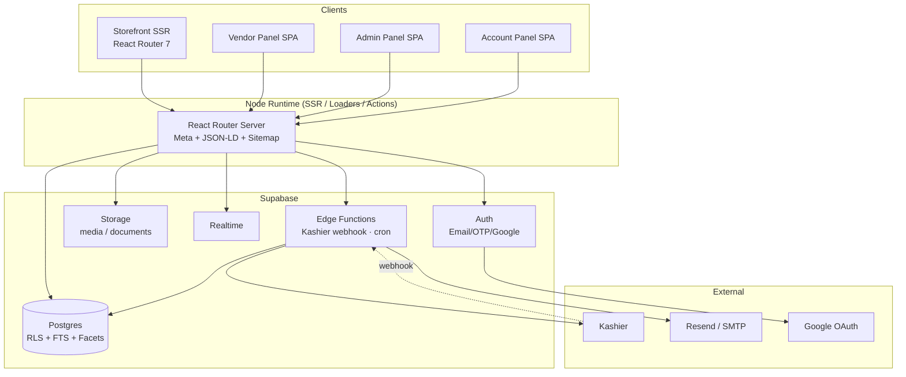
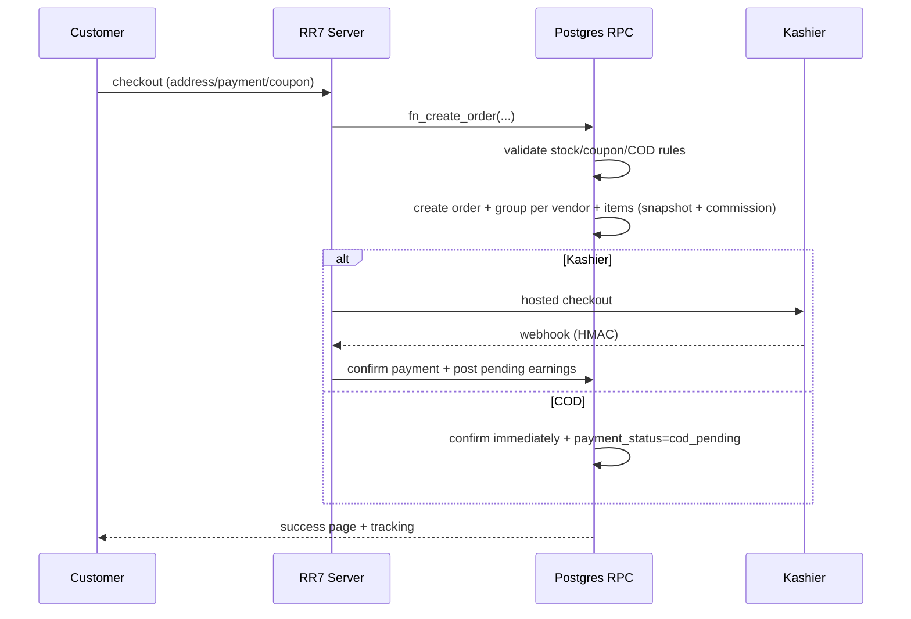

# ARCHITECTURE.md — Etsawaa

> Full architecture: layers, data model, services, flows, security, operations. Visual version: `architecture.html` (English, printable).

## 1) Guiding Principles

1. **Database is the single source of truth** — no business logic in the UI, no financial state in cache.
2. **Every financial operation is atomic** in one RPC (order/wallet/refund/ad).
3. **RLS before UI:** hiding a button is not security.
4. **SSR for public, SPA for panels:** crawlers get full HTML + schema; logged-in users get instant navigation.
5. **Everything configurable** — no hard-coded business value (commission, windows, shipping rates, COD caps, levels, packages).
6. **Simplicity first:** fewest tables that work; growth via `settings jsonb` and lookup tables.

## 2) System Map

## 3) Layers

| Layer | Responsibility | Forbidden |
|---|---|---|
| Routes/Pages | Compose screens, load data via loaders/queries | Financial math, permission checks |
| Features | View logic, hooks, schemas, RPC calls | Complex raw SQL |
| lib | supabase client, money, i18n, tokens, SEO helpers | Domain logic |
| RPC (Postgres) | All multi-row writes, money, status changes | Presentation |
| Edge Functions | Webhooks, cron, email, secret operations | UI logic |
| RLS | Isolation between roles/vendors | Relying on the client |

## 4) Roles & RLS

- `profiles.role`: `admin` · `staff` · `vendor` · `customer` (staff permissions matrix in `roles.permissions`).
- Vendor isolation: `vendor_id IN (SELECT vendor_id FROM store_members WHERE user_id = auth.uid())`.
- Customer isolation: `customer_id = auth.uid()` on carts/orders/refunds/reviews/addresses.
- Public read: `approved` products, `active` vendors, published posts, public settings only.
- `service_role` only inside Edge/RPC (webhook, wallet, commission).
- Every sensitive table: RLS on + grants revoked + policy test.

## 5) Data Model (63 tables)

> **Money naming rule:** every money column is named and stored as `*_piastres` (integer). Short names below are for readability only.

### a) Identity & Access
| Table | Key columns/constraints |
|---|---|
| `profiles` | id→auth.users, role, full_name, phone UNIQUE, **phone_alt**, avatar, locale, status |
| `roles` | slug, permissions jsonb |
| `user_addresses` | user_id, governorate_id, area_id, address1/2, postal, phone, **phone_alt (required)**, email snapshot (read-only), is_default |
| `audit_logs` | actor, action, entity, before/after jsonb, ip, at |

### b) Geography & Shipping
| Table | Notes |
|---|---|
| `governorates` | 27 governorates, `shipping_fee_piastres` |
| `areas` | each belongs to a governorate + `pickup_fee_piastres` |

### c) Vendors
| Table | Notes |
|---|---|
| `vendors` | slug, store_name_ar/en, logo/banner, socials jsonb, status, verification_status, grace_until, featured_admin_until, featured_admin_permanent, level_id, commission_override jsonb, hidden_from_listings, governorate/area |
| `store_members` | vendor_id, user_id, role |
| `vendor_documents` | type (id_front/id_back/commercial_register/tax_card/residence), path, status, reviewed_by |
| `vendor_levels` | **badge = level**: name_ar/en, icon, min_successful_orders, rewards jsonb {commission_discount_pct, ad_package_id, hold_days, free_featured_days} |
| `vendor_level_history` | vendor_id, level_id, from/to |
| `penalty_rules` | trigger_type (returns_count/defect/low_rating/packaging/manual), threshold jsonb, amount_piastres, is_active, deleted_at |
| `vendor_penalties` | vendor_id, rule_id nullable, amount_piastres, reason, ref_type/ref_id, status applied/waived, created_by |
| `payout_methods` | vendor_id, type wallet/bank/instapay, details jsonb, is_default |

### d) Catalog
| Table | Notes |
|---|---|
| `categories` | 3-level tree, depth, path (ltree), slug_ar/en, thumb, sort, is_active |
| `brands` | name, slug, thumb, sort |
| `tags` / `product_tags` | admin-managed tags |
| `attribute_defs` | leaf category_id, code, type (text/number/bool/enum/color), unit, is_required, is_filterable, **is_variant_axis**, sort |
| `attribute_options` | attribute_id, label_ar/en, color_hex, image, sort — **admin dictionary only** |
| `products` | vendor_id, leaf_category_id, brand_id, name_ar/en, slug_ar/en, desc/short, is_fragile, shipping_mode, weight_g, dims jsonb, shipping_class, status, rejection_reason, specs jsonb, search_tsv generated, featured_until, featured_permanent, event_hidden, published_at, deleted_at |
| `product_attribute_values` | (product_id, attribute_id) PK; option_id or value_text/number/bool |
| `product_facets` | (product_id, attribute_id, option_id) PK — filtering |
| `product_media` | type image/video, url, position |
| `variants` | product_id, sku UNIQUE, option_key, option_ids uuid[], price_piastres, compare_price_piastres, sale_ends_at, stock, image_url, is_active — UNIQUE(product_id, option_key) |

### e) Commerce
| Table | Notes |
|---|---|
| `carts` / `cart_items` | logged-in cart in DB, guest cart in localStorage then merged |
| `coupons` | type percent/fixed, value, free_shipping, min/max, limits (per coupon/user/items), stackable, exclude_sale_items, starts/expires, owner=admin |
| `coupon_scopes` | mode include/exclude × scope vendor/category/brand/product |
| `coupon_redemptions` | coupon/user/order |
| `orders` | order_number, customer_id, status, payment_method kashier/cod, payment_status, ship_address jsonb (name, email snapshot, phone, phone_alt, governorate, area, address), subtotal/discount/shipping/total (piastres), coupon_id |
| `order_vendor_groups` | **one per vendor**: fulfillment_status, shipping_mode (vendor if any item is vendor), vendor_ship_status pending_admin/approved/rejected, pickup_fee_total, commission_total, delivered_at, hold_until, tracking |
| `order_items` | snapshot (name/image/SKU/price), qty, unit_price, line_total, commission_rule, commission_amount, pickup_fee_each, refunded_qty |
| `order_status_history` / `order_notes` / `tracking_events` | state log, admin/public notes, manual tracking |
| `payments` | provider kashier/cod, provider_ref UNIQUE, amount, status, raw jsonb |
| `order_documents` | order_id, shipment_no (`ETS-YY-###`, one per order), type invoice_admin/invoice_vendor/label_carrier/label_vendor/packing_slip, format a4/a5, copies, printed_by, created_at |

### f) Refunds
| Table | Notes |
|---|---|
| `refund_requests` | order_id, customer_id, window_type return14/warranty30, reason, evidence[], status pending_admin→approved/rejected→completed/cancelled, admin_note |
| `refund_request_items` | request_id, order_item_id, qty, requested_amount_piastres, fault vendor/shipping/customer/defect, decision, refund_amount_piastres, restock |
| `refunds` | financial record: request_id, vendor_id, amount_piastres, method, status pending/processing/settled, provider_ref |

### g) Reviews & Wishlist
| Table | Notes |
|---|---|
| `reviews` | product_id, vendor_id, customer_id, order_item_id, rating numeric(2,1) 0.5–5, title, body, status pending/published/spam/trash, created_at |
| `wishlist_items` | user_id, product_id, created_at — UNIQUE(user_id, product_id) |
| `recently_viewed` | user_id, product_id, viewed_at — UNIQUE(user_id, product_id); keep last 20 per user |

### h) Finance
| Table | Notes |
|---|---|
| `wallets` | vendor_id PK, available_piastres, pending_piastres |
| `wallet_transactions` | type earning/commission/pickup_fee/shipping_revenue/penalty/ad_purchase/withdrawal/withdrawal_refund/refund_clawback/admin_adjustment, signed amount_piastres, reference, **reason**, created_by |
| `withdrawal_requests` | vendor_id, amount_piastres, method, details, status pending/approved/cancelled, reviewed_by, paid_at |

### i) Marketing
| Table | Notes |
|---|---|
| `ad_packages` | placement hero/footer/featured, duration_days, price_piastres, discount window, visible_to vendors/admins, slots, is_active |
| `ad_campaigns` | vendor_id, package_id, product_id, **source paid/admin_grant**, status pending_payment/active/expired/cancelled, starts/ends, impressions/clicks |
| `events` | name, starts/ends, status; Black Friday default (all November) |
| `event_vendors` | status auto/accepted/refused |
| `event_discounts` | scope category/product, percent, max_discount_piastres |
| `event_coupons` | event × coupon |

### j) Content, Settings & Media
| Table | Notes |
|---|---|
| `blog_categories` / `blog_posts` | bilingual + seo jsonb + status |
| `static_pages` | slug_ar/en, content, show_in_header |
| `banners` | platform home banners (separate from vendor ads) |
| `settings` | key/value jsonb — every section (site/general/verification/shipping/payment/policies/design/seo/media) |
| `commission_rules` | leaf_category_id, type percent/fixed/both, percent, fixed_piastres, is_active |
| `payment_methods` | provider, method, label, is_enabled, encrypted config |
| `email_templates` | key, subject/html ar/en, variables |
| `notifications` | user_id, type, payload, read_at (Realtime) |
| `email_logs` | to, template, status, error |
| `media_folders` | owner_id, parent_id (≤3 levels), name, UNIQUE(owner,parent,name) |
| `media_files` | owner_id, folder_id, bucket, path, mime, size_bytes, kind, width/height, deleted_at |

Buckets: `media` (public-read, UUID paths) · `documents` (private, signed URLs). Upload limits live in `settings.media`.

## 6) Critical Flows

### 6.1 Order creation

- **COD rejected** when `total > settings.cod_max_total` or any group ships with `vendor`.
- **One shipping fee** per order by governorate; pickup fees are internal to the vendor wallet.

### 6.2 Vendor shipping
`product.shipping_mode = vendor` → group becomes `shipping_mode = vendor` + `vendor_ship_status = pending_admin` + `orders.status = on_hold` (any vendor item forces the group and order into review).
- **Admin approves:** `shipping_revenue` transaction to the vendor for the shipping share; vendor ships; COD disabled.
- **Admin rejects:** no transaction; platform ships; `vendor_ship_status = rejected`; order continues.

### 6.3 Wallet (ledger)
- `earning` → pending on delivery; daily cron moves to available after `hold_until` (default 14 days, overridden per level).
- `pickup_fee` at ship time: quantity × vendor-area rate.
- `commission` deducted when earnings are posted (net = item − commission).
- `penalty` / `refund_clawback` / `admin_adjustment` always carry a reason. Balance **may go negative**.
- Withdrawal: request → admin review → manual transfer → approved. Never exceeds available balance (unless an explicit admin decision).

### 6.4 Refund + penalty
Customer (within 14/30 days) → `pending_admin` (vendor sees only their items) → admin decision per item + `fault` →
- `shipping`: carrier bears it → documented manual claim, no vendor deduction.
- `vendor`: automatic penalty (rule or manual amount) + `refund_clawback`.
→ Refund to customer (Kashier/manual) → `completed`. Variant stock restored.

### 6.5 Ads
Package → purchase via available unencumbered balance or Kashier (**no credit for ads**) → `ad_campaigns` → slot placement → cron expires at `ends_at`. Admin grants create the same row with `source=admin_grant`, no payment.

### 6.6 Levels/badges
Daily cron: count successful orders (delivered + hold passed) → promote to the highest eligible level → update commission/hold-days/ad grant + notify + badge shown in store.

### 6.7 Events
Active event → red notice to vendors (auto-enrolled) → refusal: hidden from listings for the period + excluded from discounts → acceptance: `event_discounts` applied to computed prices.

### 6.8 Media
Upload → type/size validation (client + edge) → `media_files` row + object at `u/{uid}/{uuid}.{ext}` → selection via MediaPicker in any form → images served with srcset. Documents go to `documents` with signed URLs; the admin page updates bucket limits through a `service_role` edge function.

### 6.9 Order documents
Order created → shipment number `ETS-YY-###` assigned once per order → documents render on demand from immutable snapshots: admin invoice (A4) + carrier label (A5, one per order, full customer data + Code128 of the shipment number) + one vendor label per vendor group (name only, own items) + optional packing slip. Settings control paper size, copies, header/footer, logo, terms, and whether vendor invoices show commission. Every render writes `order_documents`.

## 7) Routes

| Group | Routes |
|---|---|
| Public | `/` · `/:lang` · `/category/:slug` · `/products` · `/product/:slug` · `/compare` · `/store/:slug` · `/vendors` · `/brands` · `/search` · `/blog` · `/blog/:slug` · `/p/:slug` · `/sell` · `/contact` |
| Shopping | `/cart` · `/checkout` · `/order/:number` · `/order/:number/track` |
| Account | `/account` · `/account/profile` · `/account/orders` · `/account/returns` · `/account/addresses` · `/account/reviews` · `/account/wishlist` · `/account/recent` · `/account/notifications` (no media library — owner decision) |
| Vendor | `/vendor` · `/vendor/profile` · `/vendor/onboarding` · `/vendor/products` (+`/new`,`/:id/edit`) · `/vendor/orders` · `/vendor/wallet` · `/vendor/withdrawals` · `/vendor/ads` · `/vendor/reviews` · `/vendor/store` · `/vendor/reports` · `/vendor/support` · `/vendor/media` · `/vendor/orders/:id/print/:doc` |
| Admin | `/admin` · `/admin/profile` · `/admin/withdrawals` · `/admin/vendors` (+`/:id`) · `/admin/products` (+`/new`,`/:id`) · `/admin/orders` (+`/:id`) · `/admin/orders/:id/print/:doc` · `/admin/customers` · `/admin/coupons` · `/admin/catalog/{categories,brands,tags,attributes}` · `/admin/reviews` · `/admin/refunds` · `/admin/penalties` · `/admin/levels` · `/admin/ads` · `/admin/events` · `/admin/reports` · `/admin/blog` · `/admin/media` · `/admin/settings/*` · `/admin/roles` · `/admin/users` · `/admin/logs` |
| Technical | `/sitemap.xml` · `/robots.txt` · `/rss.xml` |

## 8) Scheduled Jobs (Edge Cron)

| Job | Frequency |
|---|---|
| Release earnings (pending → available) | daily |
| Evaluate vendor levels / badges | daily |
| Expire ads / events / featured flags | hourly |
| Expire vendor verification grace | daily |
| Automated penalty scans (low ratings / returns) | weekly |
| Clean dead carts/sessions | daily |
| Rebuild sitemap | on content change |

## 9) Security

- Kashier keys live in Edge secrets only — never shipped to the client.
- Webhook: HMAC verification + idempotency on `provider_ref` + reject unsigned calls.
- Document uploads: private bucket + short-lived signed links.
- Rate limiting on auth/OTP/coupon apply.
- Every status/money change is recorded in `audit_logs`.

## 10) Performance

- Facets: index `(attribute_id, option_id)`, PK-based queries.
- Arabic FTS: custom config (normalize hamza/taa marbuta/tashkeel) + `pg_trgm` for names.
- Images: Supabase CDN + srcset sizes; never raw originals.
- Pages: SSR with short cache for products/categories + revalidate on update.
- Queries: no N+1 — aggregated joins or prepared views (`v_product_card`).

## 11) Deployment

| Env | Data | Payments |
|---|---|---|
| Local | Supabase CLI + seed | Kashier sandbox |
| Staging | separate Supabase project | sandbox + test mailbox |
| Production | Supabase Pro | Kashier live + verified Resend domain |

- Migrations applied via CLI with a backup before every deploy.
- Env vars: `SUPABASE_URL/ANON_KEY` (client) · `SERVICE_ROLE/KASHIER_*/RESEND_*` (Edge only) · `SITE_URL`.

## 12) Deliberately Deferred

- Carrier APIs (Bosta/Mylerz) — manual tracking now, schema ready.
- SMS OTP — same code interface, new channel later.
- Mobile app — out of scope.
- External search engine — only beyond ~200k products.
